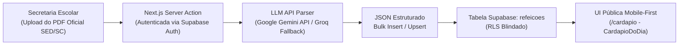

# 🍲 Arquitetura & Esquema do Banco de Dados: Alimentação Escolar (Cardápio)

**Projeto:** EEB Professor Benonívio João Martins  
**Módulo:** Cardápio / Alimentação Escolar (`refeicoes`)  
**Data de Criação:** 04 de Setembro de 2026  
**Status:** Arquitetura Aprovada & Schema Rascunhado  

---

## 🎯 1. Visão Geral & Mudança Arquitetural Crítica

A funcionalidade de **Alimentação Escolar** foi desenhada para atender pais e alunos acessando via smartphone para consultar a merenda escolar do dia sem precisar abrir ou navegar por PDFs pesados e ilegíveis em telas compactas.

### 🤖 Fluxo Automatizado com Inteligência Artificial (AI PDF Parser Workflow)
O usuário administrador (secretaria da escola) **NÃO fará digitação manual** das refeições diárias no painel. O processo é 100% automatizado:



1. **Entrada:** A secretaria faz o upload do PDF oficial de cardápio mensal emitido pelas nutricionistas da Secretaria de Estado da Educação de Santa Catarina (SED/SC).
2. **Processamento Server-Side:** Uma Server Action protegida recebe o documento no servidor Next.js e aciona o modelo de linguagem multimodal (Google Gemini API ou Groq como contingência).
3. **Extração Padronizada:** A IA processa o documento e responde exclusivamente com uma lista de objetos JSON na estrutura:
   ```json
   [
     {
       "data": "2026-09-01",
       "turno": "diurno",
       "descricao": "Arroz integral, feijão carioca, peito de frango em cubos ao molho natural, salada de cenoura e fruta da época."
     },
     {
       "data": "2026-09-01",
       "turno": "noturno",
       "descricao": "Macarronada à bolonhesa com carne moída de primeira, queijo ralado e salada fresca."
     }
   ]
   ```
4. **Gravação Atômica:** O backend executa o *bulk upsert* dos registros na tabela `refeicoes` do Supabase via chave única composta `(data, turno)`, substituindo dados anteriores sem duplicidades.

---

## 🗄️ 2. DDL SQL Completo (PostgreSQL 17 / Supabase)

Execute o script SQL abaixo no **SQL Editor** do Supabase para provisionar o banco de dados:

```sql
-- ==============================================================================
-- 1. TIPOS ENUM & EXTENSÕES
-- ==============================================================================
DO $$ 
BEGIN
  IF NOT EXISTS (SELECT 1 FROM pg_type WHERE typname = 'tipo_turno_refeicao') THEN
    CREATE TYPE tipo_turno_refeicao AS ENUM ('diurno', 'noturno');
  END IF;
END $$;

-- ==============================================================================
-- 2. TABELA DE REFEIÇÕES DO CARDÁPIO ESCOLAR
-- ==============================================================================
CREATE TABLE IF NOT EXISTS public.refeicoes (
  id UUID PRIMARY KEY DEFAULT gen_random_uuid(),
  data DATE NOT NULL,
  turno tipo_turno_refeicao NOT NULL,
  descricao TEXT NOT NULL,
  created_at TIMESTAMP WITH TIME ZONE DEFAULT timezone('utc'::text, now()) NOT NULL,
  
  -- Garante que exista apenas uma refeição cadastrada para cada turno em um mesmo dia
  CONSTRAINT uq_refeicoes_data_turno UNIQUE (data, turno)
);

-- ==============================================================================
-- 3. ÍNDICES DE ALTA PERFORMANCE
-- ==============================================================================
CREATE INDEX IF NOT EXISTS idx_refeicoes_data ON public.refeicoes (data);
CREATE INDEX IF NOT EXISTS idx_refeicoes_data_turno ON public.refeicoes (data, turno);

-- ==============================================================================
-- 4. ROW LEVEL SECURITY (RLS) & POLÍTICAS DE ACESSO
-- ==============================================================================
ALTER TABLE public.refeicoes ENABLE ROW LEVEL SECURITY;
ALTER TABLE public.refeicoes FORCE ROW LEVEL SECURITY;

-- Política 1: Leitura Pública Irrestrita (Qualquer visitante do site pode consultar)
DROP POLICY IF EXISTS "Refeicoes sao visiveis publicamente" ON public.refeicoes;
CREATE POLICY "Refeicoes sao visiveis publicamente"
  ON public.refeicoes
  FOR SELECT
  TO public
  USING (true);

-- Política 2: Inserção restrita a usuários autenticados (Admin / Server Actions)
DROP POLICY IF EXISTS "Apenas administradores autenticados podem inserir refeicoes" ON public.refeicoes;
CREATE POLICY "Apenas administradores autenticados podem inserir refeicoes"
  ON public.refeicoes
  FOR INSERT
  TO authenticated
  WITH CHECK (true);

-- Política 3: Atualização restrita a usuários autenticados (Upsert / Server Actions)
DROP POLICY IF EXISTS "Apenas administradores autenticados podem atualizar refeicoes" ON public.refeicoes;
CREATE POLICY "Apenas administradores autenticados podem atualizar refeicoes"
  ON public.refeicoes
  FOR UPDATE
  TO authenticated
  USING (true)
  WITH CHECK (true);

-- Política 4: Exclusão restrita a usuários autenticados
DROP POLICY IF EXISTS "Apenas administradores autenticados podem deletar refeicoes" ON public.refeicoes;
CREATE POLICY "Apenas administradores autenticados podem deletar refeicoes"
  ON public.refeicoes
  FOR DELETE
  TO authenticated
  USING (true);
```

---

## 🔐 3. Variáveis de Ambiente e Segurança

Para alimentar o motor de inteligência artificial de forma segura, as seguintes variáveis devem residir exclusivamente em `.env.local` e no painel da Vercel (sem prefixo `NEXT_PUBLIC_`):

| Variável | Finalidade | Escopo | Obrigatória? |
| :--- | :--- | :--- | :--- |
| `AI_API_KEY` | Chave primária da API de LLM para processamento de PDF | Servidor (`Node.js`) | Sim |
| `GEMINI_API_KEY` | Chave da Google Gemini API (modelo `gemini-1.5-flash` / `gemini-2.0-flash`) | Servidor (`Node.js`) | Sim (ou `AI_API_KEY`) |
| `GROQ_API_KEY` | Chave de contingência / fallback de alta velocidade da Groq | Servidor (`Node.js`) | Opcional |

> [!CAUTION]
> **Diretiva de Segurança:** Conforme validado pelo módulo `lib/env-guard.ts`, nenhuma chave de inteligência artificial ou token privado pode ser exposto com o prefixo `NEXT_PUBLIC_`.
